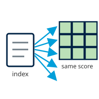

## { width="28" style="vertical-align:middle;margin-right:0.4rem;" } Contextual

!!! abstract "Learning objective"
    By the end of this page you'll be able to configure all four
    Contextual-dimension factors, understand why they're entered as a
    single national number rather than a spatial dataset, and know which
    published index backs each one.

The Contextual Dimension refers to the laws and policies that shape
workplace gender discrimination, financial autonomy, and overall gender
empowerment. Although this dimension may vary between countries due to
differences in legal frameworks, it remains consistent within a single
country, as national policies and regulations are typically applied
uniformly across countries. For more information on data input used
from open sources, see the [Getting Data
tutorial](datacollection.md#tutorial-manual-national-index-score-entry).

{ style="float:right;width:96px;margin:0 0 0.75rem 1rem;" }

Every Contextual factor uses the **National Index Score** technique (see
[Processor Types](processor-types.md#national-index-score)): a researched national score
typed straight into the factor's dialog, no spatial dataset involved.
Configure each one using the pattern from [Configuring
Items](configuring-items.md#the-generic-pattern): double-click, enter the
score, then right-click → **Run Item Workflow**. See [Getting
Data](datacollection.md#tutorial-manual-national-index-score-entry) for
how that number is calculated and entered.

### Input Contextual factors

---

#### { width="22" style="vertical-align:middle;margin-right:0.4rem;" } Generic analysis: the EPLEX score

EPLEX is a summary measure of Employment Protection Legislation (EPL)
stringency, created by the International Labour Organization (ILO),
that measures how strongly a country's laws protect workers against
dismissal at the initiative of an employer.

{ width="75%" }

Enter the EPLEX score as a fraction between 0 and 1 (the tool multiplies
it by 5 to put it on the usual 0–5 scale); if you already have a value
on the 0–5 scale from an older project, you can enter that directly and
it's used as-is.

---

#### Women's Enabling Environments analysis: the WBL database

For a Women's Enabling Environments analysis, GeoE3 uses data from the
WBL (Women, Business and the Law) database instead:

{ width="22" style="vertical-align:middle;margin-right:0.4rem;" }
**Workplace Discrimination** involves laws that address gender biases
and stereotypes that hinder women's career advancement, especially in
male-dominated fields. It's obtained from the Workplace Index score of
the WBL.

{ width="22" style="vertical-align:middle;margin-right:0.4rem;" }
**Regulatory Frameworks** pertain to laws and policies that protect
women's employment rights, such as childcare support and parental
leave, influencing their workforce participation. This indicator is
composed by the Pay and Parenthood Index score of the WBL database.

{ width="22" style="vertical-align:middle;margin-right:0.4rem;" }
**Financial Inclusion** involves laws concerning women's access to
financial resources like loans and credit, which is crucial for
starting businesses and investing in economic opportunities. This
indicator is composed by the Entrepreneurship Index score of the WBL
2024.

The WBL index scores are already 0–100, so you enter the published value
directly and GeoE3 converts it to the usual 0–5 scale for you:

| WBL score | GeoE3 score | Colour |
|---|---|---|
| 95 – 100 | 5 |  |
| 90 – 94 | 4 |  |
| 80 – 89 | 3 |  |
| 75 – 79 | 2 |  |
| 60 – 74 | 1 |  |
| 0 – 59 | 0 |  |

As a rough feel for the scale: a country with strongly enabling
legislation would score in the 90s; something clearly below that
reflects whatever gap you've identified in your research.

##### Default scores by country

If you'd rather skip the lookup entirely, the table below gives the
Workplace Discrimination, Regulatory Frameworks (average of the WBL Pay
and Parenthood scores) and Financial Inclusion score for every country
WBL covers, straight from the WBL 2024 report year (data current as of
October 1, 2023). WBL adds and revises countries each year; if you need
a different (later) report year, or a country that isn't listed below,
look it up directly at [wbl.worldbank.org](https://wbl.worldbank.org/en/wbl).

| Economy | Workplace Discrimination | Regulatory Frameworks | Financial Inclusion |
|---|---|---|---|
| Afghanistan | 50 | 10 | 75 |
| Albania | 100 | 90 | 100 |
| Algeria | 75 | 55 | 75 |
| Angola | 100 | 55 | 100 |
| Antigua and Barbuda | 50 | 47.5 | 75 |
| Argentina | 75 | 55 | 75 |
| Armenia | 75 | 87.5 | 75 |
| Australia | 100 | 100 | 100 |
| Austria | 100 | 100 | 100 |
| Azerbaijan | 100 | 65 | 100 |
| Bahamas, The | 100 | 47.5 | 75 |
| Bahrain | 75 | 70 | 100 |
| Bangladesh | 50 | 22.5 | 75 |
| Barbados | 100 | 45 | 75 |
| Belarus | 50 | 65 | 75 |
| Belgium | 100 | 100 | 100 |
| Belize | 75 | 55 | 75 |
| Benin | 100 | 67.5 | 100 |
| Bhutan | 100 | 70 | 75 |
| Bolivia | 75 | 80 | 100 |
| Bosnia and Herzegovina | 100 | 65 | 100 |
| Botswana | 25 | 37.5 | 75 |
| Brazil | 100 | 77.5 | 75 |
| Brunei Darussalam | 25 | 37.5 | 75 |
| Bulgaria | 100 | 100 | 100 |
| Burkina Faso | 100 | 52.5 | 100 |
| Burundi | 100 | 70 | 75 |
| Cabo Verde | 100 | 57.5 | 100 |
| Cambodia | 100 | 47.5 | 100 |
| Cameroon | 75 | 52.5 | 50 |
| Canada | 100 | 100 | 100 |
| Central African Republic | 100 | 45 | 75 |
| Chad | 75 | 55 | 50 |
| Chile | 75 | 87.5 | 75 |
| China | 100 | 62.5 | 75 |
| Colombia | 100 | 75 | 75 |
| Comoros | 75 | 70 | 75 |
| Congo, Dem. Rep. | 100 | 65 | 100 |
| Congo, Rep. | 75 | 22.5 | 75 |
| Costa Rica | 100 | 80 | 75 |
| Croatia | 100 | 100 | 100 |
| Cyprus | 100 | 87.5 | 100 |
| Czechia | 100 | 100 | 100 |
| Côte d'Ivoire | 100 | 90 | 100 |
| Denmark | 100 | 100 | 100 |
| Djibouti | 100 | 55 | 100 |
| Dominica | 25 | 25 | 75 |
| Dominican Republic | 100 | 67.5 | 100 |
| Ecuador | 100 | 70 | 75 |
| Egypt, Arab Rep. | 75 | 10 | 100 |
| El Salvador | 100 | 77.5 | 100 |
| Equatorial Guinea | 75 | 80 | 0 |
| Eritrea | 100 | 47.5 | 75 |
| Estonia | 100 | 100 | 100 |
| Eswatini | 25 | 35 | 0 |
| Ethiopia | 100 | 42.5 | 100 |
| Fiji | 100 | 55 | 75 |
| Finland | 100 | 90 | 100 |
| France | 100 | 100 | 100 |
| Gabon | 100 | 90 | 100 |
| Gambia, The | 50 | 67.5 | 75 |
| Georgia | 100 | 77.5 | 100 |
| Germany | 100 | 100 | 100 |
| Ghana | 100 | 35 | 75 |
| Greece | 100 | 100 | 100 |
| Grenada | 50 | 60 | 75 |
| Guatemala | 25 | 55 | 75 |
| Guinea | 100 | 35 | 100 |
| Guinea-Bissau | 25 | 47.5 | 25 |
| Guyana | 100 | 70 | 100 |
| Haiti | 50 | 70 | 75 |
| Honduras | 100 | 35 | 100 |
| Hong Kong SAR, China | 100 | 67.5 | 100 |
| Hungary | 75 | 87.5 | 100 |
| Iceland | 100 | 100 | 100 |
| India | 100 | 32.5 | 75 |
| Indonesia | 100 | 57.5 | 75 |
| Iran, Islamic Rep. | 0 | 55 | 75 |
| Iraq | 100 | 35 | 100 |
| Ireland | 100 | 100 | 100 |
| Israel | 100 | 55 | 100 |
| Italy | 100 | 100 | 100 |
| Jamaica | 75 | 35 | 75 |
| Japan | 50 | 62.5 | 75 |
| Jordan | 75 | 70 | 100 |
| Kazakhstan | 50 | 77.5 | 75 |
| Kenya | 100 | 70 | 75 |
| Kiribati | 100 | 60 | 75 |
| Korea, Rep. | 100 | 52.5 | 100 |
| Kosovo | 100 | 80 | 100 |
| Kuwait | 75 | 0 | 75 |
| Kyrgyz Republic | 100 | 32.5 | 100 |
| Lao PDR | 75 | 67.5 | 100 |
| Latvia | 100 | 100 | 100 |
| Lebanon | 100 | 35 | 75 |
| Lesotho | 75 | 47.5 | 75 |
| Liberia | 100 | 60 | 75 |
| Libya | 50 | 57.5 | 75 |
| Lithuania | 100 | 100 | 100 |
| Luxembourg | 100 | 100 | 100 |
| Madagascar | 100 | 32.5 | 75 |
| Malawi | 100 | 70 | 75 |
| Malaysia | 50 | 67.5 | 75 |
| Maldives | 100 | 57.5 | 100 |
| Mali | 50 | 55 | 75 |
| Malta | 100 | 77.5 | 100 |
| Marshall Islands | 50 | 50 | 100 |
| Mauritania | 25 | 42.5 | 75 |
| Mauritius | 100 | 80 | 100 |
| Mexico | 100 | 67.5 | 100 |
| Micronesia, Fed. Sts. | 25 | 37.5 | 75 |
| Moldova | 100 | 100 | 100 |
| Mongolia | 100 | 100 | 100 |
| Montenegro | 100 | 65 | 100 |
| Morocco | 100 | 65 | 100 |
| Mozambique | 100 | 55 | 100 |
| Myanmar | 25 | 55 | 75 |
| Namibia | 75 | 57.5 | 75 |
| Nepal | 100 | 70 | 75 |
| Netherlands | 100 | 100 | 100 |
| New Zealand | 100 | 90 | 100 |
| Nicaragua | 100 | 57.5 | 100 |
| Niger | 75 | 55 | 50 |
| Nigeria | 75 | 25 | 75 |
| North Macedonia | 100 | 65 | 100 |
| Norway | 100 | 100 | 75 |
| Oman | 50 | 55 | 75 |
| Pakistan | 100 | 35 | 75 |
| Palau | 25 | 37.5 | 75 |
| Panama | 100 | 65 | 75 |
| Papua New Guinea | 50 | 12.5 | 75 |
| Paraguay | 100 | 90 | 100 |
| Peru | 100 | 90 | 100 |
| Philippines | 100 | 80 | 100 |
| Poland | 100 | 100 | 100 |
| Portugal | 100 | 100 | 100 |
| Puerto Rico | 100 | 47.5 | 100 |
| Qatar | 0 | 25 | 75 |
| Romania | 100 | 100 | 100 |
| Russian Federation | 50 | 65 | 75 |
| Rwanda | 100 | 80 | 100 |
| Samoa | 100 | 57.5 | 75 |
| San Marino | 50 | 87.5 | 75 |
| Saudi Arabia | 100 | 70 | 100 |
| Senegal | 100 | 65 | 75 |
| Serbia | 100 | 100 | 100 |
| Seychelles | 50 | 77.5 | 75 |
| Sierra Leone | 100 | 80 | 100 |
| Singapore | 75 | 67.5 | 75 |
| Slovak Republic | 100 | 87.5 | 100 |
| Slovenia | 100 | 87.5 | 100 |
| Solomon Islands | 25 | 12.5 | 75 |
| Somalia | 50 | 45 | 75 |
| South Africa | 100 | 90 | 100 |
| South Sudan | 100 | 70 | 75 |
| Spain | 100 | 100 | 100 |
| Sri Lanka | 75 | 22.5 | 75 |
| St. Kitts and Nevis | 25 | 45 | 75 |
| St. Lucia | 100 | 70 | 75 |
| St. Vincent and the Grenadines | 25 | 35 | 75 |
| Sudan | 0 | 10 | 75 |
| Suriname | 100 | 67.5 | 50 |
| Sweden | 100 | 100 | 100 |
| Switzerland | 100 | 90 | 75 |
| Syrian Arab Republic | 25 | 20 | 75 |
| São Tomé and Príncipe | 100 | 67.5 | 75 |
| Taiwan, China | 100 | 90 | 75 |
| Tajikistan | 50 | 65 | 100 |
| Tanzania | 100 | 80 | 75 |
| Thailand | 100 | 47.5 | 75 |
| Timor-Leste | 75 | 80 | 75 |
| Togo | 100 | 90 | 100 |
| Tonga | 25 | 37.5 | 75 |
| Trinidad and Tobago | 50 | 47.5 | 100 |
| Tunisia | 75 | 32.5 | 75 |
| Türkiye | 100 | 77.5 | 75 |
| Uganda | 100 | 70 | 75 |
| Ukraine | 100 | 40 | 100 |
| United Arab Emirates | 100 | 80 | 100 |
| United Kingdom | 100 | 90 | 100 |
| United States | 100 | 77.5 | 100 |
| Uruguay | 100 | 77.5 | 75 |
| Uzbekistan | 50 | 80 | 100 |
| Vanuatu | 25 | 25 | 100 |
| Venezuela, RB | 100 | 77.5 | 75 |
| Viet Nam | 100 | 90 | 100 |
| West Bank and Gaza | 25 | 0 | 75 |
| Yemen, Rep. | 25 | 12.5 | 75 |
| Zambia | 100 | 70 | 100 |
| Zimbabwe | 100 | 57.5 | 100 |

**Citation:** World Bank. 2024. *Women, Business and the Law 2024*.
Washington, DC: World Bank. Topic-level scores (Workplace, Pay,
Parenthood, Entrepreneurship) drawn from the WBL 2024 historical panel
dataset:
[WBL2024-1-0-Historical-Panel-Data.xlsx](https://wbl.worldbank.org/content/dam/sites/wbl/documents/2024/WBL2024-1-0-Historical-Panel-Data.xlsx),
available from the WBL
[download data](https://wbl.worldbank.org/en/data/download-data) page.

!!! note
    WBL restructured its methodology starting with the 2026 report
    ("WBL 2.0"), scoring three pillars (legal frameworks, supportive
    frameworks, enforcement perceptions) per topic instead of one flat
    score. The topic-level scores this table uses are only published
    under the earlier ("1.0") methodology, which is why this table is
    pinned to the 2024 report year rather than the latest one.

---

Once every factor has a value, double-click the **Contextual** dimension
and follow the same [generic pattern](configuring-items.md#the-generic-pattern)
as every other item in the tree: assign weights, balance them, and run
it.

{ width="75%" }

The outputs (Workplace Discrimination, Regulatory Frameworks and
Financial Inclusion, plus their aggregation into the final Contextual
score) land in the Contextual folder within your project folder, on the
usual [0–5 enablement scale](the-model.md#the-05-likert-scale).

!!! success "Recap"
    - All four Contextual factors (EPLEX Score for a generic analysis;
      Workplace Discrimination, Regulatory Frameworks and Financial
      Inclusion for a Women's Enabling Environments analysis) are entered
      as a single national number, not a spatial dataset.
    - Workplace Discrimination, Regulatory Frameworks and Financial
      Inclusion map to three different WBL 2024 sub-indices (the
      Workplace, Pay and Parenthood, and Entrepreneurship index scores
      respectively). Don't reuse the same number for all three.
    - Results combine into a single Contextual output on the usual 0–5
      enablement scale, viewable as a mutually-exclusive layer group.
