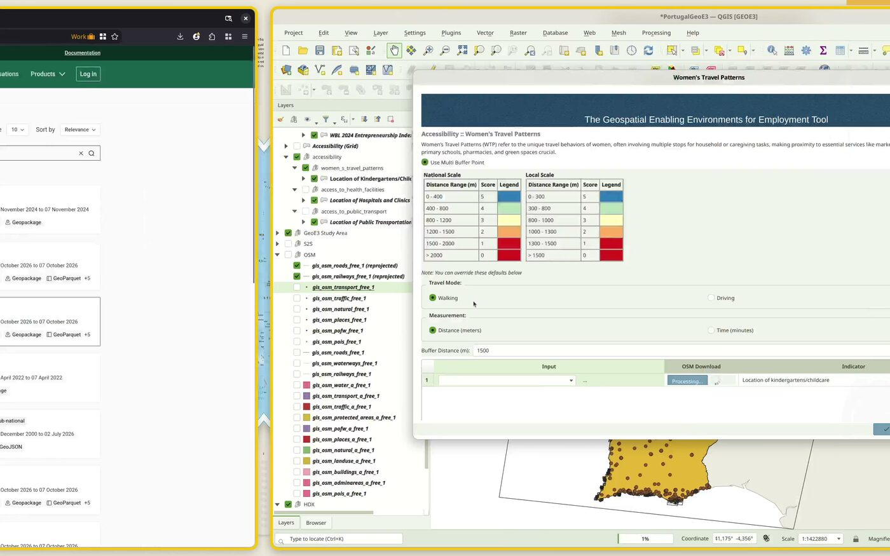
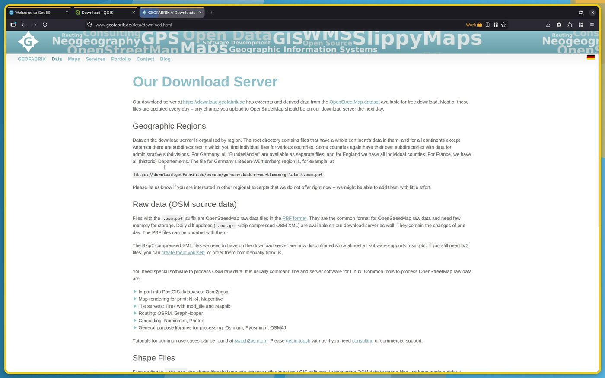

# Getting Data

!!! abstract "Learning objective"
    By the end of this page you'll know every way GeoE3 gets its input
    data — what downloads automatically, what you fetch yourself and
    import, and what you research and type in by hand — so you can source
    data confidently for any country, not just the Portugal example used
    throughout this walkthrough.

Every indicator in the GeoE3 model needs a dataset or a number behind it.
There are three distinct ways that data gets into your project:

1. **Automatic, in-app downloads** — GeoE3 fetches it for you, no browser
   required.
2. **Manual download and import** — you find a dataset on an external
   website, download it, and load it into QGIS yourself.
3. **Manual research and entry** — for national-level indicators (like
   workplace discrimination law), you research a published score and type
   a single number into the plugin.

This page works through each one as a short, self-contained tutorial. Skip
to whichever source you need.

## Tutorial: automatic downloads built into GeoE3

Several sources need no manual downloading at all:

- **OpenStreetMap, via the built-in downloader.** Most indicator
  configuration dialogs have a **Download from OSM** button. It runs a
  [QuickOSM](https://docs.3liz.org/QuickOSM/)-style query against the
  OpenStreetMap Overpass API for exactly the feature type that indicator
  needs — childcare facilities, pharmacies, banks and so on — scoped to
  your study area.

    <figure markdown>
    
    <figcaption>The <strong>OSM Download</strong> button inside an indicator dialog — here, Women's Travel Patterns.</figcaption>
    </figure>

    !!! note
        The public Overpass servers get busy and will sometimes fail or
        hang. If a download doesn't complete after a minute or two, just
        try again — it usually goes through within a few attempts.

- **Space2Stats**, a set of regional reference datasets hosted by the
  World Bank (environmental hazards, nighttime lights, demographics and
  more). If you're running a **regional**-scale analysis, the project
  setup wizard offers to prefetch all of it in one step:

    <figure markdown>
    
    <figcaption>Tick "Fetch S2S data" during project setup and GeoE3 downloads everything it needs for every Space2Stats-backed indicator.</figcaption>
    </figure>

    This is the single biggest time-saver for a regional-scale project —
    it replaces most of the manual sourcing described below.

- **GHSL** (Global Human Settlement Layer) settlement/population
  classification and **Ookla** open broadband/mobile coverage tiles both
  download automatically in the background the first time a workflow
  needs them — there's nothing to click.

## Tutorial: OpenStreetMap extracts from Geofabrik

For national or local-scale projects — where Space2Stats' regional
prefetch doesn't apply — the easiest way to get a complete, current OSM
extract for your whole country is [Geofabrik](https://www.geofabrik.de/).

<figure markdown>

<figcaption>Geofabrik's download server — free OSM extracts, updated daily, organised by continent then country.</figcaption>
</figure>

1. Go to [download.geofabrik.de](https://download.geofabrik.de/) and drill
   down: continent → country (→ sub-region, for larger countries).
2. Download the **`.gpkg.zip`** (GeoPackage) if it's offered — one file
   with every OSM layer in it, much tidier than the equivalent shapefile
   set.
3. Extract it, add it to QGIS, and right-click the folder in the
   **Browser** panel → **Add as a Favorite** so it's one click to get back
   to.

GeoPackage extracts occasionally have a malformed admin-boundaries layer.
If that happens to you, Geofabrik's shapefile download is a reliable
fallback — or use GADM (below) for boundaries specifically.

## Tutorial: official administrative boundaries from GADM

OpenStreetMap's administrative boundaries aren't always clean or
complete — coastline handling in particular can be inconsistent. When you
need an authoritative national or first-level administrative boundary,
[GADM](https://gadm.org/) is a good fallback.

<figure markdown>

<figcaption>GADM — pick your country, download a GeoPackage of its administrative boundaries at every level.</figcaption>
</figure>

Go to **Data → country**, choose your country, and download the
GeoPackage. It will contain one layer per administrative level (`ADM_0`
for the national boundary, `ADM_1` for the first subdivision, and so on).

!!! warning "Check the license before you redistribute anything"
    GADM data is free for **academic and non-commercial use**.
    Redistribution or commercial use needs permission from GADM first —
    see their [license page](https://gadm.org/license.html) before you
    publish an analysis built on it.

## Tutorial: Humanitarian Data Exchange (HDX)

[HDX](https://data.humdata.org/) is a UN OCHA-maintained catalogue of
humanitarian and development datasets — health facilities, population,
administrative boundaries and more, for most countries. GeoE3 does **not**
query HDX automatically; this is a manual browse-and-download source, the
same as Geofabrik or GADM.

1. Search HDX for your country and the data type you need (for example,
   *"health facilities Portugal"*), and tick the **geodata** filter to
   hide non-spatial results.

    <figure markdown>
    
    <figcaption>Filtering an HDX search down to geospatial datasets only.</figcaption>
    </figure>

2. Open the dataset page, scroll to **Data and Resources**, and download
   the shapefile (or GeoPackage, where offered).

    <figure markdown>
    
    <figcaption>Downloading the point-data resource for a dataset.</figcaption>
    </figure>

HDX is a good first stop for health facilities and some administrative
boundary sets, but coverage varies a lot by country — if it doesn't have
what you need, fall back to the in-app OSM downloader or Geofabrik.

## Tutorial: population data from WorldPop

Adding a demographics layer lets GeoE3 combine enablement scores with
population density (see [Exploring Your Results](insights.md)). If you
ticked **Fetch S2S data** during project setup you likely already have a
Space2Stats population layer and can skip this. If you need your own —
for a different year, or broken down by age and sex —
[WorldPop](https://hub.worldpop.org/) is an open population-data
initiative that covers most countries.

<figure markdown>

<figcaption>WorldPop's per-country age/sex breakdowns — useful if you want to target a specific demographic, not just total population.</figcaption>
</figure>

Under **Data → Age and sex structures**, pick your country and download
the GeoTIFF. The filename encodes exactly what's inside it — country
code, gender, age band, year and resolution — so you can tell at a glance
which file has, for example, working-age women.

## Tutorial: manual national index-score entry

The four Contextual-dimension factors — EPLEX Score, Workplace
Discrimination, Regulatory Frameworks and Financial Inclusion — aren't
spatial datasets at all. They're a single researched number, on a 0–100
scale, applied uniformly across the whole country (the legal and
regulatory environment doesn't vary within a border). You research the
figure from a published index, then type it into the factor's
configuration dialog.

The table below gives a worked Saint Lucia example and the general
sources to use for any other country.

## Data sources used for the Saint Lucia example

<table style="border-collapse: collapse; width: 100%; font-size: small;">
  <tr>
    <th style="border: 1px solid black; padding: 1px; text-align: center;"><b>DIMENSION</b></th>
    <th style="border: 1px solid black; padding: 1px; text-align: center;"><b>FACTOR</b></th>
    <th style="border: 1px solid black; padding: 1px; text-align: center;"><b>LAYER</b></th>
    <th style="border: 1px solid black; padding: 1px; text-align: center;"><b>DATA SOURCE/QUERY</b></th>
  </tr>

  <!-- Contextual Section with Merged DIMENSION Cell -->

  <tr>
    <td rowspan="4" style="border: 1px solid black; padding: 1px; text-align: center; ">📝CONTEXTUAL</td>
    <td style="border: 1px solid black; padding: 1px; text-align: left; ">🏢Workplace Discrimination</td>
    <td style="border: 1px solid black; padding: 1px; text-align: left; ">WBL 2024 Workplace Index Score</td>
<td style="border: 1px solid black; padding: 1px; text-align: left;">
    <a href="https://wbl.worldbank.org/en/wbl" target="_blank">
        WBL 2024 index score
    </a>
</td>

  </tr>
  <tr>
    <td style="border: 1px solid black; padding: 1px; text-align: left; ">⚖️Regulatory Frameworks</td>
    <td style="border: 1px solid black; padding: 1px; text-align: left; ">WBL 2024 Pay+Parenthood Index Score</td>
    <td style="border: 1px solid black; padding: 1px; text-align: left;">
    <a href="https://wbl.worldbank.org/en/wbl" target="_blank">
        WBL 2024 index score for Pay and Parenthood
    </a>
  </tr>
  <tr>
    <td style="border: 1px solid black; padding: 1px; text-align: left; ">💵Financial Inclusion</td>
    <td style="border: 1px solid black; padding: 1px; text-align: left; ">WBL 2024 Entrepreneurship Index Score</td>
 <td style="border: 1px solid black; padding: 1px; text-align: left;">
    <a href="https://wbl.worldbank.org/en/wbl" target="_blank">
        WBL 2024 index score for Entrepreneurship
    </a>
  </tr>
  <tr>
    <td style="border: 1px solid black; padding: 1px; text-align: left; ">🏢EPLEX</td>
    <td style="border: 1px solid black; padding: 1px; text-align: left; ">The Employment Protection Legislation Index</td>
 <td style="border: 1px solid black; padding: 1px; text-align: left;">
    <a href="https://eplex.ilo.org/en#indicators-section" target="_blank">
        EPLEX Score
    </a>
  </tr>

  <!-- Accessibility Section with Merged DIMENSION Cell -->
  <tr>
    <td rowspan="9" style="border: 1px solid black; padding: 1px; text-align: center; ">🚶ACCESSIBILITY</td>
    <td rowspan="5" style="border: 1px solid black; padding: 1px; text-align: left; ">🚶‍♀️Women's Travel Patterns</td>
    <td style="border: 1px solid black; padding: 1px; text-align: left; ">👶Location of kindergartens/childcare</td>
 <td style="border: 1px solid black; padding: 1px; text-align: left;">
    <a href="https://data.humdata.org/dataset" target="_blank">
        Humdata
    </a>
    or
    <a href="https://overpass-turbo.eu/?Q=[out:xml][timeout:25];{{geocodeArea:Saint%20Lucia}}->.area_0;(node[%22amenity%22=%22kindergarten%22](area.area_0);way[%22amenity%22=%22kindergarten%22](area.area_0);relation[%22amenity%22=%22kindergarten%22](area.area_0););(._;>;);out%20body;" target="_blank">
        OSM
    </a>
</td>
</tr>
  <tr>
    <td style="border: 1px solid black; padding: 1px; text-align: left; ">🏫Location of primary schools</td>
<td style="border: 1px solid black; padding: 1px; text-align: left;">
    <a href="https://data.humdata.org/dataset" target="_blank">
        Humdata
    </a>
   or
    <a href="https://overpass-turbo.eu/?Q=[out:xml][timeout:25];{{geocodeArea:Saint%20Lucia}}->.area_0;(node[%22amenity%22=%22school%22](area.area_0);way[%22amenity%22=%22school%22](area.area_0);relation[%22amenity%22=%22school%22](area.area_0););(._;>;);out%20body;" target="_blank">
        OSM
    </a>
</td>
  </tr>
  <tr>
    <td style="border: 1px solid black; padding: 1px; text-align: left; ">🛒Location of groceries</td>
<td style="border: 1px solid black; padding: 1px; text-align: left;">
    <a href="https://overpass-turbo.eu/?Q=[out:xml][timeout:25];{{geocodeArea:Saint%20Lucia}}->.area_0;(node[%22shop%22=%22greengrocer%22](area.area_0);way[%22shop%22=%22greengrocer%22](area.area_0);relation[%22shop%22=%22greengrocer%22](area.area_0););(._;>;);out%20body;" target="_blank">
        OSM
    </a>
</td>
  </tr>
  <tr>
    <td style="border: 1px solid black; padding: 1px; text-align: left; ">💊Location of pharmacies</td>
<td style="border: 1px solid black; padding: 1px; text-align: left;">
    <a href="https://overpass-turbo.eu/?Q=[out:xml][timeout:25];{{geocodeArea:Saint%20Lucia}}->.area_0;(node[%22amenity%22=%22pharmacy%22](area.area_0);way[%22amenity%22=%22pharmacy%22](area.area_0);relation[%22amenity%22=%22pharmacy%22](area.area_0););(._;>;);out%20body;" target="_blank">
        OSM
    </a>
</td>
  </tr>
  <tr>
    <td style="border: 1px solid black; padding: 1px; text-align: left; ">🌳Location of green spaces</td>
<td style="border: 1px solid black; padding: 1px; text-align: left;">
    <a href="https://overpass-turbo.eu/?Q=[out:xml][timeout:25];{{geocodeArea:Saint%20Lucia}}->.area_0;(node[%22leisure%22=%22park%22](area.area_0);node[%22boundary%22=%22national_park%22](area.area_0);way[%22leisure%22=%22park%22](area.area_0);way[%22boundary%22=%22national_park%22](area.area_0);relation[%22leisure%22=%22park%22](area.area_0);relation[%22boundary%22=%22national_park%22](area.area_0););(._;>;);out%20body;" target="_blank">
        OSM
    </a>
</td>
</tr>
  <tr>
    <td style="border: 1px solid black; padding: 1px; text-align: left; ">🚌Access to Public Transport</td>
    <td style="border: 1px solid black; padding: 1px; text-align: left; ">Location of public transportation stops, including maritime</td>
<td style="border: 1px solid black; padding: 1px; text-align: left;">
    <a href="https://overpass-turbo.eu/?Q=[out:xml][timeout:25];{{geocodeArea:Saint%20Lucia}}->.area_0;(node[%22public_transport%22=%22stop_position%22](area.area_0);node[%22public_transport%22=%22platform%22](area.area_0);node[%22public_transport%22=%22station%22](area.area_0);node[%22public_transport%22=%22stop_area%22](area.area_0);node[%22highway%22=%22bus_stop%22](area.area_0);node[%22highway%22=%22platform%22](area.area_0);way[%22public_transport%22=%22stop_position%22](area.area_0);way[%22public_transport%22=%22platform%22](area.area_0);way[%22public_transport%22=%22station%22](area.area_0);way[%22public_transport%22=%22stop_area%22](area.area_0);way[%22highway%22=%22bus_stop%22](area.area_0);way[%22highway%22=%22platform%22](area.area_0);relation[%22public_transport%22=%22stop_position%22](area.area_0);relation[%22public_transport%22=%22platform%22](area.area_0);relation[%22public_transport%22=%22station%22](area.area_0);relation[%22public_transport%22=%22stop_area%22](area.area_0);relation[%22highway%22=%22bus_stop%22](area.area_0);relation[%22highway%22=%22platform%22](area.area_0);node[%22amenity%22=%22ferry_terminal%22](area.area_0);way[%22amenity%22=%22ferry_terminal%22](area.area_0);relation[%22amenity%22=%22ferry_terminal%22](area.area_0););(._;>;);out%20body;" target="_blank">
        OSM
    </a>
</td>
</tr>
  <tr>
    <td style="border: 1px solid black; padding: 1px; text-align: left; ">🏥Access to Health Facilities</td>
    <td style="border: 1px solid black; padding: 1px; text-align: left; ">Location of hospitals and clinics</td>
<td style="border: 1px solid black; padding: 1px; text-align: left;">
    <a href="https://data.humdata.org/dataset" target="_blank">
        Humdata
    </a>
    or
    <a href="https://overpass-turbo.eu/?Q=[out:xml][timeout:25];{{geocodeArea:Saint%20Lucia}}->.area_0;(node[%22amenity%22=%22dentist%22](area.area_0);node[%22amenity%22=%22doctors%22](area.area_0);node[%22amenity%22=%22hospital%22](area.area_0);node[%22amenity%22=%22clinic%22](area.area_0);way[%22amenity%22=%22dentist%22](area.area_0);way[%22amenity%22=%22doctors%22](area.area_0);way[%22amenity%22=%22hospital%22](area.area_0);way[%22amenity%22=%22clinic%22](area.area_0);relation[%22amenity%22=%22dentist%22](area.area_0);relation[%22amenity%22=%22doctors%22](area.area_0);relation[%22amenity%22=%22hospital%22](area.area_0);relation[%22amenity%22=%22clinic%22](area.area_0););(._;>;);out%20body;" target="_blank">
        OSM
    </a>
</td>
</tr>
  <tr>
    <td style="border: 1px solid black; padding: 1px; text-align: left; ">🎓Access to Education and Training Facilities</td>
    <td style="border: 1px solid black; padding: 1px; text-align: left; ">Location of universities and technical schools</td>
<td style="border: 1px solid black; padding: 1px; text-align: left;">
    <a href="https://data.humdata.org/dataset" target="_blank">
        Humdata
    </a>
    or
    <a href="https://overpass-turbo.eu/?Q=[out:xml][timeout:25];{{geocodeArea:Saint%20Lucia}}->.area_0;(node[%22amenity%22=%22university%22](area.area_0);way[%22amenity%22=%22university%22](area.area_0);relation[%22amenity%22=%22university%22](area.area_0););(._;>;);out%20body;" target="_blank">
        OSM
    </a>
</td>
</tr>
  <tr>
    <td style="border: 1px solid black; padding: 1px; text-align: left; ">🏦Access to Financial Facilities</td>
    <td style="border: 1px solid black; padding: 1px; text-align: left; ">Location of Banks and other financial facilities</td>
<td style="border: 1px solid black; padding: 1px; text-align: left;">
    <a href="https://overpass-turbo.eu/?Q=[out:xml][timeout:25];{{geocodeArea:Saint%20Lucia}}->.area_0;(node[%22amenity%22=%22bank%22](area.area_0);node[%22office%22=%22financial%22](area.area_0);way[%22amenity%22=%22bank%22](area.area_0);way[%22office%22=%22financial%22](area.area_0);relation[%22amenity%22=%22bank%22](area.area_0);relation[%22office%22=%22financial%22](area.area_0););(._;>;);out%20body;" target="_blank">
        OSM
    </a>
</td>
</tr>

  <!-- Place Characterization Section with Merged DIMENSION Cell -->
  <tr>
    <td rowspan="10" style="border: 1px solid black; padding: 1px; text-align: center; ">🌍PLACE CHARACTERIZATION</td>
    <td rowspan="4" style="border: 1px solid black; padding: 1px; text-align: left; ">🚴Active Transport</td>
    <td style="border: 1px solid black; padding: 1px; text-align: left; ">🚸Location of street crossings</td>
<td style="border: 1px solid black; padding: 1px; text-align: left;">
    <a href="https://www.mapillary.com/developer/api-documentation/points" target="_blank">
        Mapillary
    </a>
   or
    <a href="https://overpass-turbo.eu/?Q=[out:xml][timeout:25];{{geocodeArea:Saint%20Lucia}}->.area_0;(node[%22highway%22=%22crossing%22](area.area_0);node[%22railway%22=%22crossing%22](area.area_0);way[%22highway%22=%22crossing%22](area.area_0);way[%22railway%22=%22crossing%22](area.area_0);relation[%22highway%22=%22crossing%22](area.area_0);relation[%22railway%22=%22crossing%22](area.area_0););(._;>;);out%20body;" target="_blank">
        OSM
    </a>
</td>
</tr>
  <tr>
    <td style="border: 1px solid black; padding: 1px; text-align: left; ">🚴‍♀️Location of cycle paths</td>
<td style="border: 1px solid black; padding: 1px; text-align: left;">
    <a href="https://overpass-turbo.eu/?Q=[out:xml][timeout:25];{{geocodeArea:Saint%20Lucia}}->.area_0;(node[%22highway%22=%22cycleway%22](area.area_0);node[%22highway%22=%22track%22](area.area_0);node[%22cycleway%22=%22track%22](area.area_0);node[%22cycleway%22=%22lane%22](area.area_0);node[%22cycleway%22=%22share_busway%22](area.area_0);node[%22cycleway%22=%22shared_lane%22](area.area_0);way[%22highway%22=%22cycleway%22](area.area_0);way[%22highway%22=%22track%22](area.area_0);way[%22cycleway%22=%22track%22](area.area_0);way[%22cycleway%22=%22lane%22](area.area_0);way[%22cycleway%22=%22share_busway%22](area.area_0);way[%22cycleway%22=%22shared_lane%22](area.area_0);relation[%22highway%22=%22cycleway%22](area.area_0);relation[%22highway%22=%22track%22](area.area_0);relation[%22cycleway%22=%22track%22](area.area_0);relation[%22cycleway%22=%22lane%22](area.area_0);relation[%22cycleway%22=%22share_busway%22](area.area_0);relation[%22cycleway%22=%22shared_lane%22](area.area_0););(._;>;);out%20body;" target="_blank">
        OSM
    </a>
</td>
</tr>
  <tr>
    <td style="border: 1px solid black; padding: 1px; text-align: left; ">👣Location of footpaths</td>
<td style="border: 1px solid black; padding: 1px; text-align: left;">
    <a href="https://overpass-turbo.eu/?Q=[out:xml][timeout:25];{{geocodeArea:Saint%20Lucia}}->.area_0;(node[%22highway%22=%22footway%22](area.area_0);way[%22highway%22=%22footway%22](area.area_0);relation[%22highway%22=%22footway%22](area.area_0););(._;>;);out%20body;" target="_blank">
        OSM
    </a>
</td>
</tr>
  <tr>
    <td style="border: 1px solid black; padding: 1px; text-align: left; ">🏘️Block Layout</td>
<td style="border: 1px solid black; padding: 1px; text-align: left;">
    <a href="https://overpass-turbo.eu/?Q=[out:xml][timeout:25];{{geocodeArea:Saint%20Lucia}}->.area_0;(node[%22landuse%22=%22residential%22](area.area_0);node[%22landuse%22=%22commercial%22](area.area_0);node[%22landuse%22=%22industrial%22](area.area_0);node[%22boundary%22=%22administrative%22](area.area_0);way[%22landuse%22=%22residential%22](area.area_0);way[%22landuse%22=%22commercial%22](area.area_0);way[%22landuse%22=%22industrial%22](area.area_0);way[%22boundary%22=%22administrative%22](area.area_0);relation[%22landuse%22=%22residential%22](area.area_0);relation[%22landuse%22=%22commercial%22](area.area_0);relation[%22landuse%22=%22industrial%22](area.area_0);relation[%22boundary%22=%22administrative%22](area.area_0););(._;>;);out%20body;" target="_blank">
        OSM
    </a>
</td>
</tr>

  <tr>
    <td style="border: 1px solid black; padding: 1px; text-align: left; ">🛡️Safety Perception</td>
    <td style="border: 1px solid black; padding: 1px; text-align: left; ">Street lights/Nighttime lights</td>
<td style="border: 1px solid black; padding: 1px; text-align: left;">
    <a href="https://www.mapillary.com/developer/api-documentation/points" target="_blank">
        Mapillary
    </a>
   or
    <a href="https://eogdata.mines.edu/products/vnl/" target="_blank">
        NTL
    </a>
</td>
</tr>
  <tr>
    <td style="border: 1px solid black; padding: 1px; text-align: left; ">⚠️FCV</td>
    <td style="border: 1px solid black; padding: 1px; text-align: left; ">ACLED data</td>
<td style="border: 1px solid black; padding: 1px; text-align: left;">
    <a href="mailto:civanescu@worldbank.org">
      mail for ACLED data
    </a>
</td>
</tr>
  <tr>
    <td style="border: 1px solid black; padding: 1px; text-align: left; ">📚Education</td>
    <td style="border: 1px solid black; padding: 1px; text-align: left; ">Share of graduates by field, female (%)</td>
<td style="border: 1px solid black; padding: 1px; text-align: left;">
    <a href="https://genderdata.worldbank.org/en/indicator/se-ter-grad-fe-zs?fieldOfStudy=Science%2C+Technology%2C+Engineering+and+Mathematics+%28STEM%29">
        WB data</a>
</td>
</tr>
  <tr>
    <td style="border: 1px solid black; padding: 1px; text-align: left; ">💻Digital Inclusion</td>
    <td style="border: 1px solid black; padding: 1px; text-align: left; ">Individuals using the Internet (% of population)</td>
<td style="border: 1px solid black; padding: 1px; text-align: left;">
    <a href="https://genderdata.worldbank.org/en/indicator/it-net-user-zs">
        WB data</a>
</td>
</tr>
  <tr>
  <td style="border: 1px solid black; padding: 1px; text-align: left;">🌋Environmental Hazards</td>
  <td style="border: 1px solid black; padding: 1px; text-align: left;">Global Natural Hazards Data</td>
  <td style="border: 1px solid black; padding: 1px; text-align: left;">
    <strong>General Data Source:</strong>  
    <a href="https://datacatalog.worldbank.org/int/search/dataset/0067117/Active-Fires-density-2003-2022" target="_blank">Fires</a> |
    <a href="https://datacatalog.worldbank.org/int/search/dataset/0067118/flood_hazard_100_year_return_period" target="_blank">Flood</a> |
    <a href="https://datacatalog.worldbank.org/int/search/dataset/0067119/Landslide-Susceptibility" target="_blank">Landslides</a> |
    <a href="https://datacatalog.worldbank.org/int/search/dataset/0067120/Tropical-Cyclone-Frequency" target="_blank">Tropical Cyclones</a> |
    <a href="https://datacatalog.worldbank.org/int/search/dataset/0067121/Global-Drought-Hazard-based-on-SPEI" target="_blank">Drought</a>
      
  </td>
</tr>
  <tr>
    <td style="border: 1px solid black; padding: 1px; text-align: left; ">💧Water Sanitation</td>
    <td style="border: 1px solid black; padding: 1px; text-align: left; ">Water points</td>
<td style="border: 1px solid black; padding: 1px; text-align: left;">
    <a href="https://www.mapillary.com/developer/api-documentation/points" target="_blank">
        Mapillary
    </a>
    or
    <a href="https://overpass-turbo.eu/?Q=[out:xml][timeout:25];{{geocodeArea:Saint%20Lucia}}->.area_0;(node[%22emergency%22=%22fire_hydrant%22](area.area_0);node[%22emergency%22=%22water_tank%22](area.area_0);node[%22amenity%22=%22drinking_water%22](area.area_0);node[%22amenity%22=%22water_point%22](area.area_0);way[%22emergency%22=%22fire_hydrant%22](area.area_0);way[%22emergency%22=%22water_tank%22](area.area_0);way[%22amenity%22=%22drinking_water%22](area.area_0);way[%22amenity%22=%22water_point%22](area.area_0);relation[%22emergency%22=%22fire_hydrant%22](area.area_0);relation[%22emergency%22=%22water_tank%22](area.area_0);relation[%22amenity%22=%22drinking_water%22](area.area_0);relation[%22amenity%22=%22water_point%22](area.area_0););(._;>;);out%20body;" target="_blank">
        OSM
    </a>
</td>
</tr>
</table>

### General sources for other countries

While the table above is specific to Saint Lucia, the same kinds of
sources exist for most countries:

1. **World Bank — Women, Business and the Law (WBL)**: indices on
   workplace discrimination, regulatory frameworks and financial
   inclusion.
2. **ILO EPLEX**: employment protection legislation index.
3. **UNDP**: gender equality, economic participation and sustainable
   development metrics.
4. **National statistics offices**: gender-disaggregated data for
   contextual and accessibility indicators.
5. **OpenStreetMap**: locations of facilities for accessibility and
   active-transport indicators (via the in-app downloader, Geofabrik, or
   [overpass-turbo.eu](https://overpass-turbo.eu/) directly).
6. **Humanitarian Data Exchange (HDX)**: schools, health facilities and
   other infrastructure.
7. **World Bank environmental hazards catalogue**: fire, flood,
   landslide, cyclone and drought layers.
8. **Mapillary**: crowdsourced street-level imagery, useful for street
   crossings, sidewalks and public lighting where OSM coverage is thin.
9. **VIIRS Nighttime Lights (NTL)**: a proxy for safety perception where
   no dedicated safety-perception dataset exists.

### Data attribution

GeoE3 pulls from whichever external datasets and services your workflow
and inputs actually use — typically some combination of OpenStreetMap,
OpenRouteService, GHSL (European Commission JRC), Ookla Open Data,
Space2Stats, ACLED and VIIRS Nighttime Lights. When you publish or share
an analysis, check and include the attribution, citation text and
license/terms for whichever of these you actually used — they're not all
the same license.

!!! success "Recap"
    - GeoE3 gets data three ways: automatic in-app download (OSM,
      Space2Stats, GHSL, Ookla), manual download-and-import (Geofabrik,
      GADM, HDX, WorldPop), and manual research-and-entry (the four
      Contextual factors).
    - For a regional-scale project, ticking **Fetch S2S data** during
      project setup covers most of your data needs in one step.
    - For national or local-scale projects, you'll do more manual
      sourcing — Geofabrik for OSM extracts, GADM for clean admin
      boundaries, HDX and WorldPop for everything else.
    - Check data licenses before you redistribute results — GADM in
      particular restricts commercial/redistribution use without
      permission.
