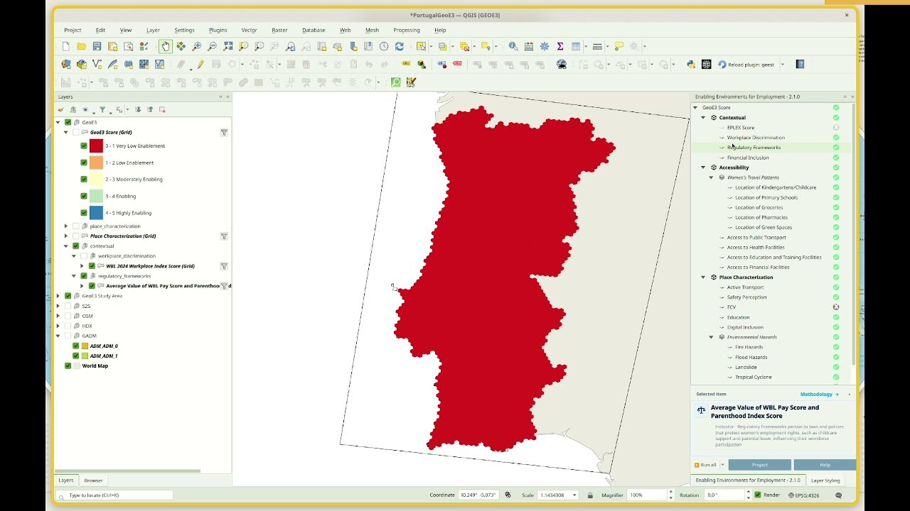
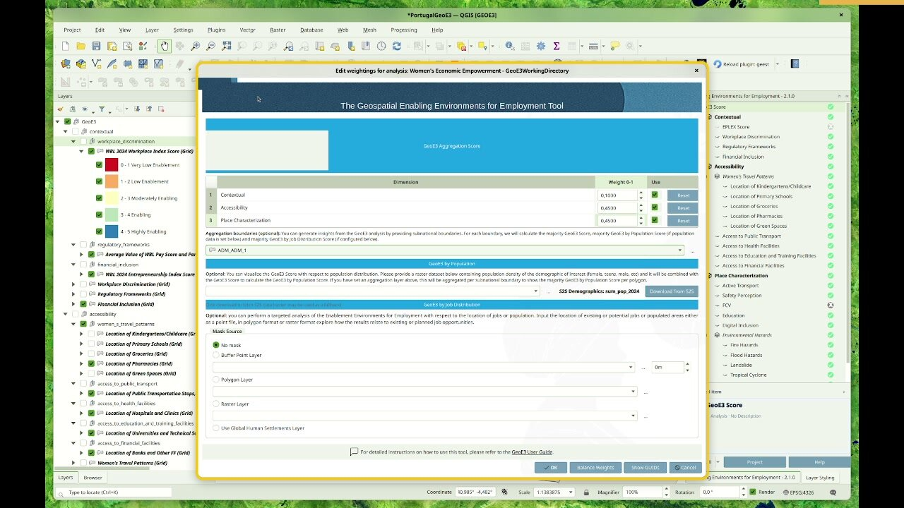

## Exploring Your Results

!!! abstract "Learning objective"
    By the end of this page you'll be able to compute the final GeoE3
    score, read its 5-class enablement legend, enrich it with population
    and subnational boundaries, and understand the bivariate legend that
    results from combining enablement with population density.

The final aggregation of all three dimensions is carried out by applying weights to each dimension, ensuring a balanced and comprehensive representation. This tab provides users with deeper insights by identifying regions where conditions are optimal—or at least favorable—for women to access job opportunities in a specific sector. The outputs from this tab assign a combined classification score to the input raster, aggregate results at desired adminstrative level and extract aggregated polygons or administrative units intersecting these regions. Additionally, GeoE3 highlights key infrastructure investments that could boost women's participation in the workforce. Population data can also be incorporated into the analysis to provide more nuanced insights that account for both population levels and enablement. This process integrates proximity data, classification scores, population data and weighted dimensions to support informed decision-making.

Once every dimension has been processed (see the three previous pages),
we can see a new layer added at the analysis node for the GeoE3 score.
Looking at the data, it's in a Likert scale: red cells are very low
economic enablement, orange is low, yellow is intermediate, green is
enabling, and blue is very enabling.

<figure markdown>

<figcaption>Every item in the tree shows a green checkmark once its workflow has run — the GeoE3 Score itself is the weighted combination of all three dimensions, on the same 0–5 scale as everything underneath it.</figcaption>
</figure>

We're able to go and explore all of the individual results as well — you
can click on any layer and you'll see a description of it at the bottom,
in the info panel (you can shrink this panel and resize it back again),
including the methodology that was used to calculate it. For example,
Workplace Discrimination uses a single factor applied equally to all
cells throughout the region.

You can go through and explore the different results generated at the
dimension level, then the factor level, and down at the indicator level —
remembering that the combination of indicators is combined into the
factor. If you double-click on a factor, you can see in a table the
weightings used to say what the relative importance of each was in the
total assessment, and factor weightings are in turn combined into
dimension scores, which you can see and change the same way (weighting
0 to 1; press **Balance Weights** after changing one).

### Computing the GeoE3 Score
---

Before accessing the full insights tab, it is necessary to aggregate all the factors processed in the previous steps. This is achieved by assigning weights to each dimension, resulting in the GeoE3 output. The output is categorized into five classes: highly enabling, enabling, moderately enabling, low enablement and very low enablement.

> - 🖱️🖱️ **Double-click** on the **GeoE3 Score section** to open the pop-up.
> - ⚖️ **Assign Weights**: Ensure the **weights** are correctly assigned, as they determine the relative importance of each factor in the analysis. Carefully review these values to ensure they are aligned with your project's objectives and reflect the significance of each factor accurately.
> - 🚫 **Exclude Unused Dimensions (optional)**: If a specific dimension is not intended to be included in the process, uncheck the **Use** button associated with it.
> - 🔄 **Readjust Weights**: After excluding any dimensions, make sure to **Balance Weights** of the remaining ones. This step ensures the weight distribution remains balanced and totals correctly, preserving the integrity of the analysis, then click **OK** to proceed.

After configuring the dimensions and adjusting their weights to achieve balance, you can initiate the process workflow:

> - 🖱️**Right-click on GeoE3 Score**.
> - ▶️**Select Run Item Workflow** from the context menu.

The process should be successfully completed and indicated by a green checkmark widget.

### Optional Steps After Defining the WEE Score
---

GeoE3 can be visualized in relation to male/female population distribution by providing a raster dataset containing male/female population density and/or by job distribution by providing job locations. These datasets are combined with the GeoE3 score to calculate the GeoE3 by Population score and/or GeoE3 by Job Distribution score. If an administrative layer is defined, results are aggregated by subnational boundaries to display the predominant WEE outputs for each region.

All of these optional steps live in the same dialog as the dimension
weights — double-click the GeoE3 Score node to open it, and there are
extra options beyond the weightings for the three dimensions. Let's go
through those one by one:

<figure markdown>

<figcaption>Dimension weights, aggregation boundaries, the GeoE3 by Population demographics source, and the GeoE3 by Job Distribution mask options, all in one dialog.</figcaption>
</figure>

First there's **aggregation boundaries** — set this to, for example,
Admin 1, and that means you can then break the results down further by
subnational units. Then there's the option to set a **demographics
layer**: click **Download from S2S** and it will fetch it for you, or you
can provide your own population dataset — one common place to get that
is [WorldPop](datacollection.md#tutorial-population-data-from-worldpop),
which provides free open population data if you need a specific year or
a breakdown by age and sex.

You can also choose a **mask**. If you're trying to pilot economic
upliftment in specific areas, you could use the mask layer to filter out
all the cells outside that area. One way to do that is using the Global
Human Settlements layer, which masks everything to just where it's
highly settled — but you can also use your own raster, points buffered
by a certain distance, or a polygon layer.

#### 1. Aggregation Boundaries (Optional)

This step allows aggregating the GeoE3 analysis results by subnational boundaries (e.g., districts, provinces).
> - 🛠️ **What to do**: Select or upload a layer containing subnational boundaries (e.g., administrative polygons).
> - 📊 **What can be done**: Calculate the majority GeoE3 score for each boundary. If population data is available, calculate the majority GeoE3 by Population score for each boundary. If job distribution data is configured (see Step 3), calculate the majority GeoE3 by Job Distribution score for each boundary.

#### 2. GeoE3 by Population (Optional)

This step combines female population data with the GeoE3 score to provide insights into population-weighted WEE results.

> - 🛠️ **What to do**: Upload or select a raster dataset containing female population density.
> - 📊 **What can be done**: Combine the population data with WEE scores to calculate the GeoE3 by Population score. If an aggregation layer has been defined (in Step 1), the results will be summarized per subnational boundary to show the predominant GeoE3 by Population score. The final output is a comprehensive dataset consisting of 15 classes, representing a combination of 5 levels of enablement and 3 population density categories: low, medium and high.

#### 3. GeoE3 by Job Distribution (Optional)

This step enables targeted analysis based on job locations, identifying areas where GeoE3 intersects with job opportunities.

> - 🛠️ **What to do**: Upload or select job location data, either as:
>   - Point Layer: Locations of individual jobs (e.g., existing or planned job sites).
>   - Polygon Layer: Job regions (e.g., industrial zones or employment clusters).
>   - Raster Layer: Job density data in raster format.
>   - Specify a buffer distance for point data to analyze the surrounding area.
>   - The Mask Source section allows limiting the analysis to specific areas based on:
>   - Buffer Point Layer: Creates a buffer around points (e.g., job sites or facilities).
>   - Polygon Layer: Limits analysis to selected polygons (e.g., administrative regions or zones).
>   - Raster Layer: Uses raster data to define areas for focused analysis.
> - 📊 **What can be done**: Explore how GeoE3 scores relate to existing or planned job opportunities. Identify areas with high GeoE3 potential that align with job locations. Can restrict the analysis to areas of specific interest, such as around job sites, within administrative boundaries, or in high-density regions.

 

After configuring the optional features you can initiate the process workflow:

> - 🖱️**Right-click on GeoE3 Score**.
> - ▶️**Select Run Item Workflow** from the context menu.

### Visualizing the Outputs
---

After completing the process, the outputs are automatically added to the Layer Panel in QGIS as a group layer. This group layer has the *Mutually Exclusive Group* feature activated, which ensures that only one layer within the group can be visible at a time. When this feature is enabled, turning on the visibility of one layer automatically turns off the visibility of the others within the same group, making it easier to compare results without overlapping visualizations.

The outputs consist of all GeoE3 score outputs (aggreagated at administrative level, by population or by job distribution). All scores are assessed on a scale from 0 to 15, categorized as follows: 14 - 15: Highly enabling, high population | 13 - 14: Highly enabling, medium population | 12 - 13: Highly enabling, low population | 11 - 12: Enabling, high population | 10 - 11: Enabling, medium population | 9 - 10: Enabling, low population | 8 - 9: Moderately enabling, high population | 7 - 8: Moderately enabling, medium population | 6 - 7: Moderately enabling, low population | 5 - 6: Low enablement, high population | 4 - 5: Low enablement, medium population | 3 - 4: Low enablement, low population | 2 - 3: Very low enablement, high population | 1 - 2: Very low enablement, medium population | 0 - 1: Very low enablement, low population.

 

The outputs are stored within the project folder created during the setup phase as raster files. These files can be shared and further utilized for various purposes, such as visualization in QGIS or other GIS software, integration into reports, overlaying with other spatial datasets, or performing advanced geospatial analyses, such as identifying priority areas or conducting trend analysis based on the scores.

If the results do not immediately appear in the Layer Panel after processing the GeoE3 Scores, you can resolve this by either adding them manually from the folder path or by right-clicking on the GeoE3 Score and selecting **Add to map** from the context menu.

When population and a subnational boundary layer are both configured,
**Add GeoE3 Aggregates to Map** breaks the enablement scores down by
subnational district — and in this case we have not five categories but
15, because each area has a bivariate legend combining population and
enablement. Dark red is low enablement and low population; light red is
low enablement but high population; the best would be bright blue, high
enablement with high population.

<figure markdown>

<figcaption>Each subnational region shaded by its majority class — combining 5 enablement levels with 3 population tiers (low/medium/high) gives the 15 categories in the legend.</figcaption>
</figure>

There's one more advanced option worth knowing about — the subnational
score matrix — covered in [The Analysis Report & Raw Data](report.md)
along with the rest of what's in the PDF report.

**🖥️ Key attributes of GeoE3 Score tab**

 

<table border="1" style="border-collapse: collapse; width: 100%; text-align: left;">
  <tr style="border: 1px solid black;">
    <td style="border: 1px solid black;"><strong>1. Edit Weights and Settings</strong></td>
    <td style="border: 1px solid black;">Allows users to modify weights and settings for the analysis.</td>
  </tr>
  <tr style="border: 1px solid black;">
    <td style="border: 1px solid black;"><strong>2. Show Attributes</strong></td>
    <td style="border: 1px solid black;">Displays detailed attribute data for the items in the analysis.</td>
  </tr>
  <tr style="border: 1px solid black;">
    <td style="border: 1px solid black;"><strong>3. Clear Item</strong></td>
    <td style="border: 1px solid black;">Removes the selected item from the analysis.</td>
  </tr>
  <tr style="border: 1px solid black;">
    <td style="border: 1px solid black;"><strong>4. Clear Results</strong></td>
    <td style="border: 1px solid black;">Clears all previously generated results.</td>
  </tr>
  <tr style="border: 1px solid black;">
    <td style="border: 1px solid black;"><strong>5. Run Item Workflow</strong></td>
    <td style="border: 1px solid black;">Executes the workflow.</td>
  </tr>
  <tr style="border: 1px solid black;">
    <td style="border: 1px solid black;"><strong>6. Add GeoE3 Score to Map</strong></td>
    <td style="border: 1px solid black;">Adds the Women’s Enablement Environment (WEE) score to the map display.</td>
  </tr>
  <tr style="border: 1px solid black;">
    <td style="border: 1px solid black;"><strong>7. Add GeoE3 by Population to Map</strong></td>
    <td style="border: 1px solid black;">Displays WEE scores combined with population data on the map.</td>
  </tr>
  <tr style="border: 1px solid black;">
    <td style="border: 1px solid black;"><strong>8. Add GeoE3 Aggregates to Map</strong></td>
    <td style="border: 1px solid black;">Visualizes aggregated WEE scores on the map.</td>
  </tr>
  <tr style="border: 1px solid black;">
    <td style="border: 1px solid black;"><strong>9. Add Masked Scores to Map</strong></td>
    <td style="border: 1px solid black;">Adds scores that are filtered or masked to the map display.</td>
  </tr>
  <tr style="border: 1px solid black;">
    <td style="border: 1px solid black;"><strong>10. Add Job Opportunities Mask to Map</strong></td>
    <td style="border: 1px solid black;">Overlays a mask of job opportunities on the map.</td>
  </tr>
  <tr style="border: 1px solid black;">
    <td style="border: 1px solid black;"><strong>11. Add Study Area to Map</strong></td>
    <td style="border: 1px solid black;">Displays the study area boundaries on the map.</td>
  </tr>
  <tr style="border: 1px solid black;">
    <td style="border: 1px solid black;"><strong>12. Open Log File</strong></td>
    <td style="border: 1px solid black;">Opens the log file to review detailed workflow processes or errors.</td>
  </tr>
  <tr style="border: 1px solid black;">
    <td style="border: 1px solid black;"><strong>13. Open Working Directory</strong></td>
    <td style="border: 1px solid black;">Opens the directory containing the project files.</td>
  </tr>
</table>

 

Every run also produces a full PDF analysis report, and the raw grid
results are available for export to CSV or any GIS format — both covered
next, in [The Analysis Report & Raw Data](report.md).

!!! success "Recap"
    - The GeoE3 Score combines the three dimensions you've already
      configured, weighted and run just like any other item in the tree.
    - Adding a population layer (auto-fetched from Space2Stats, or your
      own — see [WorldPop](datacollection.md#tutorial-population-data-from-worldpop))
      unlocks the 15-class bivariate legend: 5 enablement levels × 3
      population tiers.
    - Adding a subnational boundary layer breaks results down by region;
      adding a mask (GHSL settlements, or your own) restricts the
      analysis to areas you actually care about.
    - The **Subnational score matrix** setting (Settings → Options →
      GeoE3, off by default) adds a region-by-factor breakdown table to
      the PDF report.
