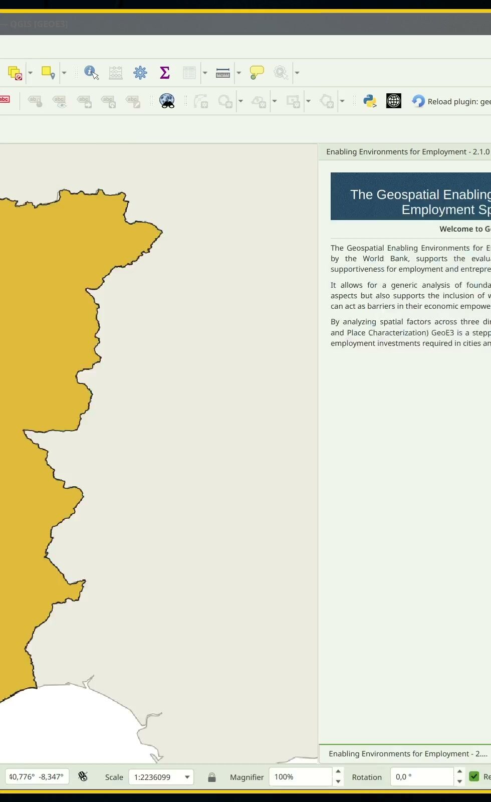
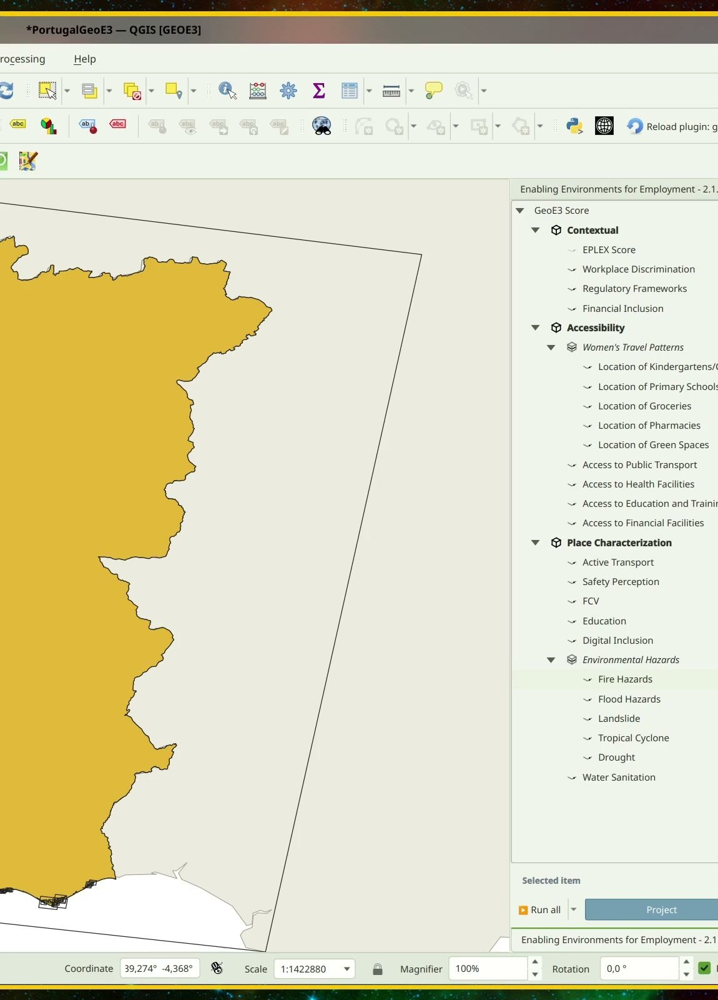

# Project Setup

!!! abstract "Learning objective"
    By the end of this page you'll be able to open GeoE3, create a new
    analysis project from a boundary layer, choose the right scale for
    your study area, set up a routing environment, and read the model
    tree that every other page in this walkthrough configures.

This page assumes you've already [installed QGIS and the GeoE3
plugin](../getting-started/installation.md) and have some data to work
with — if not, see [Getting Data](datacollection.md) first.

## Opening the plugin

Once installed, you'll find GeoE3's icon in the QGIS toolbar. Click it to
open the panel, which docks to the right-hand side of the window by
default.

  

> 1. **Locate the Toolbar Icon**  
> Find the plugin's icon in the QGIS toolbar.
>
> 2. **Open the Plugin**
> Click on the plugin's toolbar icon to open its main window.

The first page is a short welcome and overview; the next explains what
the tool does and who built it. Use the arrow buttons at the bottom of
the panel to move between pages.

<figure markdown>

<figcaption>The welcome panel — a one-paragraph summary of what GeoE3 does, shown every time you open a project.</figcaption>
</figure>

## Opening or creating a project

Next, GeoE3 asks you to choose a project folder — every analysis lives in
its own folder, which the plugin manages for you.

**Open an Existing Project** loads a project folder you've already set up
and configured — pick this to carry on where you left off.

**Create a New Project** walks you through setting one up from scratch,
which is what the rest of this page covers.

!!! warning
    The folder you choose must be **empty**. GeoE3 treats everything in
    it as its own — using a folder that already has other files in it can
    lead to errors or accidental overwrites. Give it a descriptive name
    (country/region plus a date is a good pattern) so you can find it
    again later.

## Creating a new project

Creating a project is one wizard: pick a scale, point it at your
boundary layer, and decide whether to include women-specific factors.

<figure markdown>

<figcaption>Scale, grid size, boundary layer and the Women's Enabling Environments toggle, all in one step.</figcaption>
</figure>

**Scale of analysis** — pick whichever matches what you're studying:

| Scale    | Typical use                      | Default grid size |
|----------|-----------------------------------|--------------------|
| Regional | Multi-country or continental study | ~30 km hex cells  |
| National | A single country                  | 1000 m             |
| Local    | A city or small region             | 100 m              |

All three default grid sizes can be overridden — smaller cells give more
detail but take longer to process. Regional scale also unlocks the
Space2Stats prefetch step covered in [Getting
Data](datacollection.md#tutorial-automatic-downloads-built-into-geoe3).

**Boundary layer** — point this at your Admin0 (national boundary) layer
and tell it which column holds the country/area name. If you're not sure
your boundary data is clean, see the
[GADM](datacollection.md#tutorial-official-administrative-boundaries-from-gadm)
and
[HDX](datacollection.md#tutorial-humanitarian-data-exchange-hdx)
tutorials — OpenStreetMap's admin boundaries aren't always reliable,
especially around coastlines.

**Women's Enabling Environments** — leave this ticked to analyze through
the lens of the Geospatial Women's Employment Analytical Framework
(GeoWEAF), which is what the rest of this walkthrough demonstrates. GeoE3
can equally run a generic economic-enablement analysis with this
unticked; some women-specific factors (and the Contextual dimension's
EPLEX scoring) are only available with it on.

### What happens next: the study area grid

Once you confirm, GeoE3 builds a grid across your whole study area and
writes it into a GeoPackage, together with a set of **mask** layers — a
mask is a raster that's `1` inside your study area and NoData everywhere
outside it, used to clip every later result to the right shape. For a
regional analysis this is an H3 hexagon grid; national and local scale
use square grid cells.

 

When it finishes, a **Study Area Report** opens automatically, summarizing
how many grid cells were created, how long each part of the country took
to process, and where the generated files live (your project folder's
`study_area/` subfolder). You can reopen it any time.

 

### Setting up routing

Several Accessibility indicators need to know travel time or distance
along the real road network — for example, how far someone has to walk
or drive to reach a clinic. GeoE3 offers two engines for this:

- **QGIS's native routing** (`native:serviceareafromlayer`) — the
  default. No API key, no setup, just slower on large areas.
- **OpenRouteService (ORS)** — faster, but needs a free API key from
  [openrouteservice.org](https://openrouteservice.org/). Paste the key
  into the settings panel here, or set an `ORS_API_KEY` environment
  variable.

Either way, you need a road network. If you've already downloaded OSM
data (see [Getting Data](datacollection.md)), point GeoE3 at the roads
layer — GeoE3 will reproject it into the analysis CRS automatically if
needed. If you don't have one yet, click **Download from OpenStreetMap**
to fetch one directly.

 

## Reading the model tree

With the project created, you land on the **Processing Data Interface** —
the model tree you'll spend most of your time in. It organizes every
piece of the analysis into three levels:

<figure markdown>

<figcaption>The complete model tree for a Women's Enabling Environments analysis — 3 dimensions, 16 factors, 35 indicators.</figcaption>
</figure>

- **Dimensions** (3): Contextual, Accessibility, Place Characterization —
  the broadest grouping, each with its own weight in the final score.
- **Factors** (16 across the three dimensions): the themes you'll
  configure one by one — Workplace Discrimination, Women's Travel
  Patterns, Active Transport, and so on.
- **Indicators** (35 in total): the actual calculated layers. Most
  factors are a single indicator; a couple — Women's Travel Patterns and
  Environmental Hazards — expand into five indicators each (childcare,
  schools, groceries, pharmacies and green space for the former; fire,
  flood, landslide, cyclone and drought for the latter).

<figure markdown>

<figcaption>The data processing interface: dimensions and factors on the left, status widgets on the right.</figcaption>
</figure>

**Status widgets.** Each row in the tree shows a small icon telling you
what state that item is in:

| Status | Meaning |
|---|---|
| Configured, not run | Inputs are set up but the workflow hasn't been executed yet |
| Required, not configured | Essential inputs are still missing |
| Completed successfully | Processing finished without errors |
| Workflow failed | Something went wrong — needs troubleshooting |
| Not configured (optional) | Optional inputs, left unset |
| Excluded from analysis | Deliberately disabled, won't be run or counted |

**Run All** (bottom of the panel) runs every workflow regardless of
status; **Run Incomplete** only runs the ones that haven't completed yet.
The **Project** button takes you back to the setup pages above if you
need to change the scale or boundary layer later, and **Help** opens the
plugin's GitHub documentation.

Configuring every item in this tree — pointing each factor at its data,
or entering a researched national score — is exactly what the next few
pages walk through, dimension by dimension.

!!! success "Recap"
    - GeoE3 projects live in their own empty folder; pick **Create a New
      Project** to start one from a boundary layer.
    - The scale you choose (regional/national/local) sets a default grid
      size and, for regional, unlocks the Space2Stats prefetch.
    - Routing for accessibility indicators defaults to QGIS's free native
      engine; OpenRouteService is faster but needs an API key.
    - The model tree has three levels — dimension → factor → indicator —
      and a status icon on every row tells you what's left to configure.
