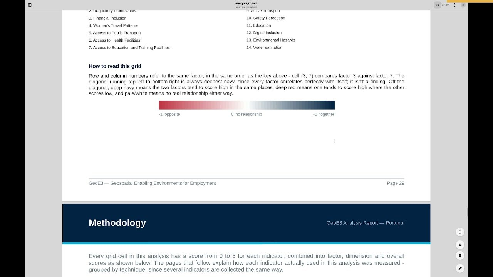

# The Analysis Report & Raw Data

!!! abstract "Learning objective"
    By the end of this page you'll know how to navigate the PDF analysis
    report GeoE3 generates after every run, interpret its correlation and
    color-matrix pages, and get at the raw grid results yourself —
    whether that's loading them as a vector/raster layer or exporting to
    CSV for a spreadsheet or statistics package.

Alongside producing all the different outputs, we also get a PDF report
that gets produced. You can pull that up at any time by right-clicking
the analysis node and saying **Show Analysis Report** — it will take a
few minutes to generate.

## Reading the report

This report is a summary of the entire analysis. It tries to cover the
high-level results, then also describe the methodology, and then also
provide some more detailed analysis results.

The first page has the credits for our partners that funded the plugin
and the data attribution for the different data sources we used. Then we
describe the legend — the five classes that are key to understanding the
different visualizations we produce — and we also describe the 15-class
legend, where we have high-density population with low enablement
through to high enablement with low density of population.

Each of the different analysis levels — then dimensions, factors and
indicators — are printed out along with sparklines, or bar charts,
showing the breakdown of how many pixels fall into each category. If you
configured an aggregation boundary, you then get the breakdowns by
subnational units too: the majority GeoE3 score, the subnational
aggregated score (what most of the cells are at each subnational region),
and masked by GHSL.

After that there's a list of the different indicators, dimensions and
factors, presenting the whole data set as a colour matrix — the
subnational districts as rows, and each factor as a column, so you can
use it to visually look for outliers.

<figure markdown>

<figcaption>The methodology page states the scale explicitly: every grid cell is scored 0–5 for each indicator, combined into factor, dimension and overall GeoE3 scores.</figcaption>
</figure>

### Making sense of the correlation heatmap

This visualization shows how factors relate to each other. When they
relate to each other positively — in other words, if one scores higher
the other one is also likely to score high — they get put into the blue
end of the colour space. If they relate to each other negatively, that
is to say if one scores low the other one is also likely to score low,
they get put into the red colour space. Low access to public transport,
for example, tends to correlate with low water and sanitation access —
this can help you pick out different socio-economic patterns in the
data.

### The methodology pages

You get a diagrammatic representation of the methodology showing
indicators being aggregated by the factor weighting into factors, which
are then aggregated by the dimension weighting into dimensions, which
are then again aggregated by the analysis weighting into the final GeoE3
score. Then we describe the methodology for each of the different
analysis approaches we do:

- For the **Contextual** dimension, we basically fill all the pixels
  with the same value, because the legislative environment is the same
  across the whole country.
- For others, we count how many features there are per cell, or
  determine a buffer around points — if you fall within the buffer, that
  resource is accessible to you, and if you don't, it's not.
- There's the **network-style analysis**, where we build isochrones —
  contour lines of equal travel time around a point, like a clinic — so
  we can see what kind of population catchment that facility provides.
- And the last category is data that's basically ready-to-use, like
  flood data, where all we have to do is reclassify it into our
  five-category class.

At the end of the report we have the scoring weights — the actual
weightings used for each of the different dimensions in the analysis —
and the very last thing is the time, so you can see how long each
analysis step took. This is useful if you want to go and optimize things,
or understand why something isn't running as quickly as you'd like. There
are also some notes about the scale and number of grid cells and the
region used for the analysis.

## Accessing the raw data yourself

One last thing worth showing is how to access the raw data that's
produced. GeoE3 adds layer groups to your project with a nested structure
similar to the model tree — you can see all the outputs for each
dimension, and each one shows the details relating to it. Right-click
over any node and you'll see a whole bunch of menu items starting with
**Add**:

- **Add GeoE3 Score to Map** — as either a vector grid or a raster grid.
  If you want to work with the vector grid, you can go and look in its
  attribute table and see all of the indices that were calculated across
  the whole study area — export this to a CSV, take it to your AI
  application or a spreadsheet, and do further numerical interpretation
  using that software.
- **Add GeoE3 Aggregates to Map** — the subnational breakdown, like you
  saw in the PDF report. If you use the **Identify** tool you can click
  on any one of these and see the area name and the majority score —
  basically the highest score for the region.
- There are more products in the menu too: outputs masked by job
  opportunities, the global human settlements layer used for the
  settlements masking, and so on.
- **Open Working Directory** takes you to the place where all of the
  analytical outputs were produced, including the reports and all of the
  data sets that were made during the analysis.

!!! tip "Advanced: the subnational score matrix"
    One other thing worth knowing: if you go into **Settings → Options →
    GeoE3**, there's a box you can tick, **Subnational score matrix**.
    It's an advanced option and it's not on by default — turning it on
    gets you an additional table in the report, every region and its
    scoring against every factor, that gives you a way to visualize the
    economic environment across all the different subnational boundaries
    and quickly pick out interesting factors. In a Portugal example run,
    one factor was red for every single region — that turned out to be a
    Contextual factor (Regulatory Frameworks) set to a low value for the
    whole country. Another factor was low for some regions and not
    others — that one was Women's Travel Patterns, meaning some areas are
    conducive to women's travel and others not so much. The table
    identifies factors by number rather than name, so keep the legend
    page handy, or an aggregation boundary table that maps your region
    codes to their friendly names.

!!! success "Recap"
    - **Show Analysis Report** on the analysis node generates a full PDF:
      credits and legends, every output with its distribution, subnational
      breakdowns, a factor correlation colour matrix and heatmap, and the
      methodology and weights actually used.
    - The correlation heatmap: blue means two factors move together, red
      means they move in opposite directions.
    - The underlying grid is yours to use beyond QGIS — add it as a
      vector layer and export its attribute table to CSV for further
      analysis elsewhere.
    - **Open Working Directory** gets you straight to every file this
      analysis produced.

That should get you up and running with the basics of using the GeoE3
plugin — from an empty QGIS install through to a finished, reportable
analysis. There are more things you can do beyond this walkthrough: the
[Legacy Detailed Reference](../about/legacy-detailed-reference.md) covers
a few individual factors in more granular detail, and
[About](../about/index.md) has the background on the framework this tool
implements.

If you'd like to get in touch — feedback, questions, or to help — the
[Acknowledgements](../about/acknowledgements.md) page has contact details
for the team.
